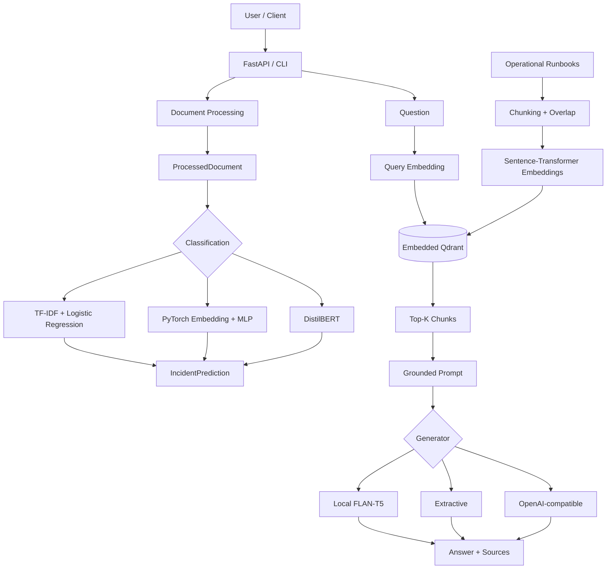

# OpsMind AI

**End-to-end incident intelligence and grounded RAG platform built as an AI Engineering portfolio project.**

OpsMind turns operational incident text and runbooks into a complete AI application: document ingestion, three classification approaches, semantic vector retrieval, grounded RAG, evaluation, REST APIs, automated tests, and GitHub Actions CI.

> **Status:** v1.0.2 — feature scope frozen for portfolio use. This release intentionally uses local Python execution and embedded Qdrant to keep the project lightweight and reproducible on a normal development machine.

## What OpsMind does

Given operational text such as a PostgreSQL timeout, packet-loss report, application crash, Redis memory issue, Kubernetes `CrashLoopBackOff`, or TLS failure, OpsMind can:

1. **Classify the incident** with one of three model families.
2. **Retrieve semantically relevant runbook chunks** from a Qdrant vector store.
3. **Generate a grounded answer** from retrieved evidence and return the source chunks.
4. Expose those capabilities through both a **CLI** and **FastAPI**.

## Architecture



Detailed design: [`docs/ARCHITECTURE.md`](docs/ARCHITECTURE.md)

## Technology map

| Concern | Implementation |
|---|---|
| Document ingestion | Python, async pipeline, TXT/Markdown loaders |
| Classical baseline | TF-IDF + Logistic Regression (`scikit-learn`) |
| Neural NLP | PyTorch `Embedding` + masked mean pooling + MLP |
| Transfer learning | DistilBERT / Hugging Face Transformers |
| Embeddings | `sentence-transformers/all-MiniLM-L6-v2` |
| Vector search | Embedded Qdrant, cosine similarity, metadata payloads |
| RAG | Grounded prompt + pluggable generators |
| API | FastAPI + Pydantic |
| Configuration | `.env` / environment variables |
| Evaluation | Accuracy/F1, Hit@K/MRR, source hit, keyword recall |
| Testing | pytest |
| CI | GitHub Actions, Python 3.11 / 3.13 |

## Measured portfolio results

The committed evaluation evidence is intentionally small and curated. It demonstrates the pipeline and evaluation methodology; it is **not** a production benchmark.

### Retrieval

- 6 runbooks indexed
- 13 chunks
- 384-dimensional normalized embeddings
- 6 curated evaluation queries
- **Hit@1: 1.00**
- **Hit@3: 1.00**
- **MRR: 1.00**

### RAG

- 4 curated evaluation queries
- **Source hit rate: 1.00**
- **Mean keyword recall: 0.4167**

The split result is useful engineering evidence: retrieval found the expected evidence consistently in the small fixture, while generation quality was less stable. That localizes the next quality-improvement target to the generator/prompt rather than the vector-search layer.

See [`docs/EVALUATION.md`](docs/EVALUATION.md) and the committed sample reports in [`docs/evaluation/samples/`](docs/evaluation/samples/).

## Quick start

### Requirements

- Python 3.11–3.14
- Internet access for first-time Hugging Face model downloads

### Install on Windows PowerShell

```powershell
python -m venv .venv
Set-ExecutionPolicy -Scope Process -ExecutionPolicy RemoteSigned
.\.venv\Scripts\Activate.ps1
python -m pip install --upgrade pip
python -m pip install -e ".[dev]"
Copy-Item .env.example .env
```

Verify the repository:

```powershell
.\scripts\verify-local.ps1
```

## Classification

Train/load commands are kept separate so each model family can be inspected independently:

```powershell
opsmind train
opsmind train-neural
opsmind train-transformer
opsmind run-all
```

The three approaches are preserved deliberately:

- **Classical:** strong small-data baseline with TF-IDF + Logistic Regression.
- **Neural from scratch:** exposes vocabulary, token IDs, embeddings, pooling, training loops, and checkpointing.
- **Pretrained Transformer:** demonstrates transfer learning and Hugging Face model serving.

## Semantic retrieval

Build the local runbook vector index:

```powershell
opsmind index-retrieval
```

Search it:

```powershell
opsmind search-retrieval --query "a kubernetes pod keeps restarting in CrashLoopBackOff"
```

Evaluate retrieval:

```powershell
opsmind eval-retrieval
```

The default configuration uses **embedded persistent Qdrant** under `data/vector_store/qdrant`; no separate database server is required for local use.

## Grounded RAG

Default local provider:

```text
OPSMIND_LLM_PROVIDER=hf_local
OPSMIND_LLM_MODEL=google/flan-t5-small
```

Ask a question:

```powershell
opsmind rag-ask --query "PostgreSQL requests are timing out and the connection pool is full. What should I check?"
```

Evaluate RAG:

```powershell
opsmind eval-rag
```

For deterministic smoke tests without a generation-model download:

```powershell
$env:OPSMIND_LLM_PROVIDER="extractive"
```

## FastAPI

Start the API:

```powershell
opsmind serve
```

Interactive OpenAPI docs:

```text
http://127.0.0.1:8000/docs
```

Endpoints:

| Method | Endpoint | Purpose |
|---|---|---|
| `GET` | `/health` | process/version health |
| `POST` | `/v1/classify` | incident classification |
| `POST` | `/v1/retrieve` | semantic Top-K retrieval |
| `POST` | `/v1/ask` | grounded RAG answer + sources |

Example RAG body:

```json
{
  "query": "A Kubernetes pod is stuck in CrashLoopBackOff. What should I inspect?",
  "top_k": 3
}
```

## Continuous Integration

`.github/workflows/ci.yml` runs automatically on pushes and pull requests. It tests Python 3.11 and 3.13, validates installed dependencies, compiles the source, and runs pytest.

This repository implements **CI (Continuous Integration)**. Automated production deployment is intentionally out of scope for this portfolio release, so the project does not claim a CD pipeline.

## Repository layout

```text
src/opsmind/
├── api/                # FastAPI schemas and routes
├── loaders/            # TXT / Markdown ingestion
├── processing/         # cleaning and normalization
├── models/             # shared domain result objects
├── ml/
│   ├── neural/         # PyTorch NLP model
│   └── transformer/    # DistilBERT training/inference
├── retrieval/          # chunking, embeddings, Qdrant, retrieval evaluation
├── rag/                # prompting, generators, RAG service/evaluation
├── config.py           # validated environment configuration
├── pipeline.py         # document-processing orchestration
├── reporting.py        # JSON reports
├── services.py         # service composition / shared resources
└── main.py             # CLI orchestration

data/
├── input/              # sample incidents
├── training/           # labeled classification fixture
├── knowledge/          # runbook knowledge base
├── evaluation/         # curated retrieval/RAG evaluation fixtures
├── models/             # runtime artifacts (ignored by Git)
├── output/             # runtime reports (ignored by Git)
└── vector_store/       # embedded Qdrant persistence (ignored by Git)

docs/                   # architecture, evaluation, publishing, interview/resume notes
scripts/                # local verification and GitHub preflight checks
tests/                  # automated regression tests
.github/workflows/      # GitHub Actions CI
```

## Key engineering decisions

- Shared domain contracts decouple model implementations from reporting and API layers.
- Training and inference persist preprocessing/model metadata together to reduce training-serving mismatch.
- Retrieval is framework-light so chunking, embeddings, vector storage, ranking, and metrics remain visible.
- Retrieval and generation are evaluated separately to localize RAG failures.
- The FastAPI process caches heavyweight classifier/retrieval/RAG services instead of rebuilding them per request.
- OpsMind v1.0.1 fixed a real embedded-Qdrant resource-lifecycle bug by sharing one retrieval service across `/v1/retrieve` and `/v1/ask`, with a regression test.
- OpsMind v1.0.2 removes unverified container tooling from the portfolio release and keeps the documented runtime aligned with what was actually tested locally.
- Runtime model artifacts, Qdrant storage, `.env`, generated outputs, caches, and updater backups are intentionally excluded from Git.

## Known limitations / next steps

- Evaluation fixtures are small and curated.
- The local `flan-t5-small` generator demonstrates the RAG architecture but is not a production-quality operational assistant.
- A production iteration should expand the evaluation set, compare stronger generators, add answer-groundedness/faithfulness checks, and define latency/quality acceptance thresholds.
- Automated production deployment is intentionally out of scope for this portfolio release.

## Portfolio material

- Architecture: [`docs/ARCHITECTURE.md`](docs/ARCHITECTURE.md)
- Evaluation: [`docs/EVALUATION.md`](docs/EVALUATION.md)
- Validation checklist: [`docs/VALIDATION.md`](docs/VALIDATION.md)
- GitHub publishing: [`docs/GITHUB_PUBLISHING.md`](docs/GITHUB_PUBLISHING.md)
- Resume bullets: [`docs/RESUME.md`](docs/RESUME.md)
- Interview talking points: [`docs/INTERVIEW_GUIDE.md`](docs/INTERVIEW_GUIDE.md)
- Changelog: [`CHANGELOG.md`](CHANGELOG.md)
