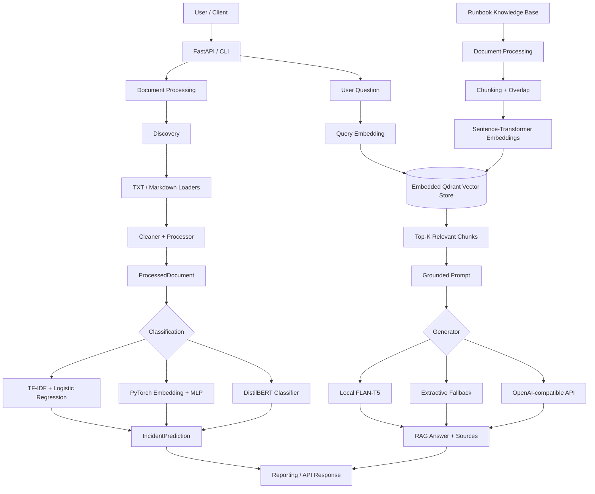

# OpsMind Architecture

OpsMind is an end-to-end incident-intelligence application. The same codebase covers document ingestion, supervised classification, semantic retrieval, grounded RAG, API serving, evaluation, and engineering automation.

## System diagram



## Core boundaries

- **Document layer:** discovers, loads, cleans, validates, and normalizes operational documents.
- **Classification layer:** exposes three independent approaches behind the same `IncidentPrediction` contract.
- **Retrieval layer:** chunks runbooks, embeds text, persists vectors and metadata in embedded Qdrant, and performs semantic Top-K search.
- **RAG layer:** combines retrieved evidence with a generator and keeps source chunks attached to the answer.
- **API layer:** exposes health, classification, retrieval, and RAG through HTTP while caching heavyweight services per process.
- **Evaluation layer:** measures retrieval independently from generation so failures can be localized.
- **Engineering layer:** package metadata, validated environment configuration, automated tests, GitHub preflight checks, and GitHub Actions CI.

## Main request flows

### Classification

```text
HTTP /v1/classify or CLI
        ↓
ProcessedDocument
        ↓
Selected classifier
        ↓
IncidentPrediction
        ↓
JSON response/report
```

### Retrieval

```text
Question
   ↓
Sentence embedding (384 dimensions)
   ↓
Embedded Qdrant cosine search
   ↓
Top-K chunks + metadata + scores
```

### RAG

```text
Question
   ↓
Semantic retrieval
   ↓
Top-K runbook chunks
   ↓
Grounded prompt
   ↓
Generator
   ↓
Answer + source chunks
```

## Local runtime

The portfolio release intentionally uses a lightweight local runtime:

```text
Windows / macOS / Linux
        ↓
Python virtual environment
        ↓
OpsMind application
        ├── FastAPI / CLI
        ├── local Hugging Face models
        └── embedded persistent Qdrant
```

A separate vector-database service is not required for the documented local workflow.
